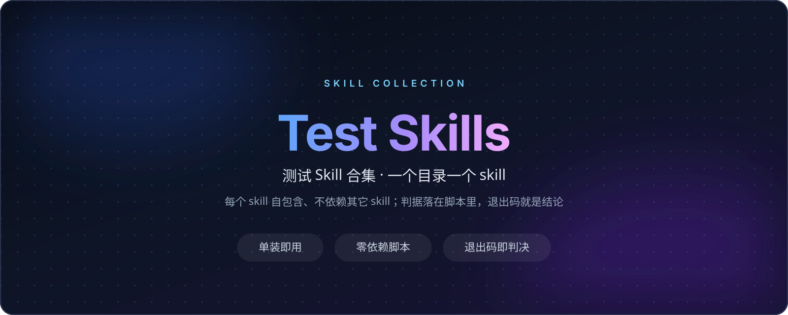
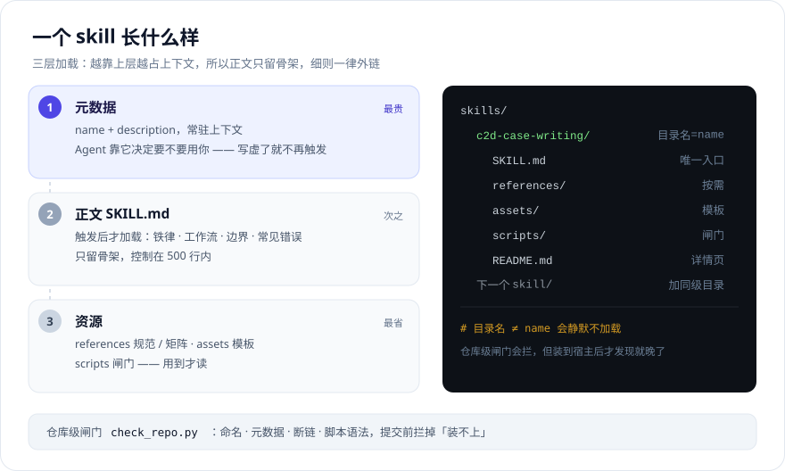

[简体中文](./README.md) | [English](./README.en.md)

<p align="center">
  
</p>

<h1 align="center">xxuntuil-test-skills</h1>

<p align="center"><strong>Testing skills, installable one at a time.</strong></p>

<p align="center">One directory per skill: copy it into your host's skills folder and it works. No changes to your repo.<br>Each ships its own output format, red lines and a machine-runnable gate, with no dependency on its siblings.</p>

<p align="center">
  <a href="https://github.com/Jasonlya/xxuntuil-test-skills/actions/workflows/check.yml"></a>
  <a href="./skills/"></a>
  
  
  <a href="./LICENSE"></a>
</p>

---

No prompts here, and no framework that only runs once every piece is installed. Each skill stands alone: copy one directory and it works, it does not reference its siblings, it does not touch your repo, and removing it leaves nothing behind.

Three admission criteria. Miss one and it does not get in: **a fixed output format**, **decidable completion criteria**, **at least one machine-checkable red line**. The third is the hard gate, because a rule that only lives in prose gets skipped; a rule that lives in a script ends as an exit code. That is also why every gate here ships a negative sample — proving it can pass is worthless until you have proven it can block.

[Skills](#skills) · [What a skill looks like](#what-a-skill-looks-like) · [Repo-level checks](#repo-level-checks) · [Install](#install) · [Adding a skill](#adding-a-skill) · [Compatibility](#compatibility) · [Measured results](#measured-results)

## Skills

| Skill | What it solves | Trigger phrases | Version |
|---|---|---|---|
| [c2d-case-writing](./skills/c2d-case-writing/README.md) | Image-validation test cases for design-to-code (C2D): every case carries a real image URL plus a statement of why that image triggers the rule | C2D image validation, MasterGo image export | `v0.1.0` |
| [requirement-analysis](./skills/requirement-analysis/README.md) | Requirement modelling: a 12-section model, testability four questions, and A/B/C automation grading, with a mandatory source on every conclusion | Requirement analysis, testability assessment, can this be automated | `v0.1.0` |

Planned (not written yet, deliberately kept out of the table): test strategy, case review, API contract testing, flaky-test triage.

The bias is **few but solid**. Ten "looks complete" skills are worth less than a handful that each carry measured results and a gate. Full rules in [CONTRIBUTING.md](./CONTRIBUTING.md).

## What a skill looks like

<p align="center">
  
</p>

Three-layer loading decides how to write one: metadata (`name` + `description`) is permanently in context, so it is **the only thing that decides whether the skill triggers** — write it vaguely and it never gets used. The body loads only after triggering, so keep it a skeleton. Rules, templates and scripts load on demand, so details live there.

Two hard constraints:

- **Directory name == frontmatter `name`.** A mismatch fails silently at load time — the single most common failure mode.
- **Each skill has its own `README.md` detail page.** The repo README is an index only. Piling one skill's details onto the front page makes the repo look like it exists for that one skill.

## Repo-level checks

`scripts/check_repo.py` covers "won't load" problems, independent of any skill's domain logic:

| Level | Checks | Exit code |
|---|---|---|
| E | Missing `SKILL.md`, unclosed frontmatter, missing `name` / `description`, `name` ≠ directory, invalid or over-long name, short `description`, local absolute paths, broken internal references, Python syntax errors | 1, blocks the commit |
| W | Missing `displayName` / `version`, `SKILL.md` over 500 lines, skill missing from this README, `skills-N` badge out of sync with the real count | 0, advisory |

Runs on push and PR (`.github/workflows/check.yml`), and locally:

```bash
python3 scripts/check_repo.py
```

Domain gates (say, test-case red lines) belong to each skill under its own `scripts/` and stay out of the repo-level check.

## Install

```bash
git clone git@github.com:Jasonlya/xxuntuil-test-skills.git
cd xxuntuil-test-skills
./install.sh                    # all skills → ~/.workbuddy/skills/
```

Pure copy; no host configuration is touched. Overwriting an installed skill **renames the old directory to `.bak.<timestamp>` instead of deleting it**.

```bash
./install.sh --list                          # what's in the repo
./install.sh c2d-case-writing                # install one
./install.sh -d ~/proj/.workbuddy/skills     # project-scoped, shared through git
```

| Scope | Directory | Applies to |
|---|---|---|
| Personal | `~/.workbuddy/skills/` | Every project |
| Project | `<repo>/.workbuddy/skills/` | That repo only; travels with git |

Upgrade: `git pull`, rerun the same command. Uninstall: delete the skill directory from your host; the repo always keeps the full set.

**Confirm it is actually loaded**: open a new session and ask the question the skill is meant to trigger on. Success means you can see the agent read `SKILL.md`. A directory on disk does not mean the skill triggers.

## Repository layout

```text
skills/                    One directory per skill
  <name>/
    SKILL.md               Single entry: metadata + red lines + workflow
    README.md              Detail page: full description and measured results
    references/            Loaded on demand: rules, checklists, matrices
    assets/                Copy-ready templates
    scripts/               That skill's own gates
scripts/check_repo.py      Repo-level checks
.github/workflows/check.yml  Runs the checks on push and PR
install.sh                 Installer (single / all / project-scoped / backup-on-overwrite)
assets/                    README artwork, grouped per skill (e.g. assets/c2d/)
```

## Adding a skill

```bash
mkdir -p skills/<name>/{references,assets,scripts}
# write SKILL.md (directory name must equal its `name`) and a README.md detail page
python3 scripts/check_repo.py          # local checks; E-level must reach zero
```

Five rules (the first two are enforced by the script):

1. **Directory name == frontmatter `name`**, lowercase with hyphens, ≤40 chars.
2. **`description` states three things**: what it does, when to use it, the literal trigger phrases.
3. **Keep the body a skeleton** — details to `references/`, templates to `assets/`, runnable logic to `scripts/`; stay under 500 lines.
4. **Machine-check what can be machine-checked**, and state what the gate cannot judge.
5. **Never invent facts.** Unknown field names or thresholds become `TODO: confirm {what} with {whom}`.

Also add the new skill to the table above and bump the `skills-N` badge — `check_repo.py` warns about both, but a human still has to make the edit.

## Compatibility

Distributed as Markdown instructions, relative-path references and on-demand standard-library scripts. No SDK.

| Host | Directory | Verified scope |
|---|---|---|
| WorkBuddy | `~/.workbuddy/skills/` or project `.workbuddy/skills/` | Primary target; tested locally |
| Claude Code | `~/.claude/skills/` or project `.claude/skills/` | Layout compatible; output quality not measured there |
| Other `SKILL.md` hosts | Per their rules | Adaptable layout; triggering and output need separate verification |

All skill instructions are in Chinese. Native Windows is not covered (use WSL); no non-macOS platform has been tested.

## Measured results

Repo-level (macOS · Python 3.13 · 2026-11-26):

| Scenario | Result |
|---|---|
| `check_repo.py` negative test (name mismatch, broken reference, local path, script syntax error) | All four reported, exit 1 |
| Same script on the healthy repo | 0 E / 0 W, exit 0 |
| CI (push and PR) | Same script as local; latest run passed |

Each skill's own measurements live on its detail page — e.g. [c2d-case-writing's gates and fixtures](./skills/c2d-case-writing/README.md#实测记录) (template passes with zero errors; a broken sample is blocked with 11 errors; all 13 fixtures return 200).

**What is not here**: no with-skill vs without-skill quality comparison has been run, so this README claims no percentage improvements.

## Documentation

| Document | When to read it |
|---|---|
| [skills/c2d-case-writing/README.md](./skills/c2d-case-writing/README.md) | You want to use that skill; full description and measurements |
| [skills/c2d-case-writing/SKILL.md](./skills/c2d-case-writing/SKILL.md) | You want to see how it works (this is what the agent reads) |
| [CONTRIBUTING.md](./CONTRIBUTING.md) | You want to add a skill or change one |
| [CHANGELOG.md](./CHANGELOG.md) | Version history |
| [LICENSE](./LICENSE) | MIT |

## Contributing

See [CONTRIBUTING.md](./CONTRIBUTING.md). Reproducible issues and concrete requests go to [Issues](https://github.com/Jasonlya/xxuntuil-test-skills/issues).

## License

[MIT](./LICENSE)
