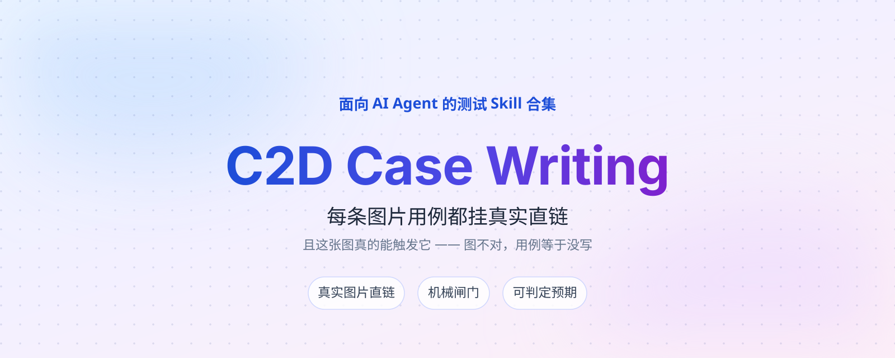
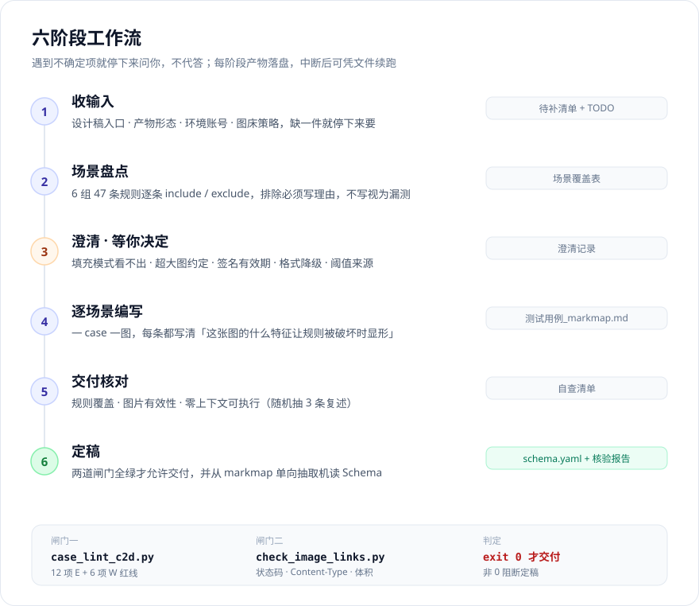
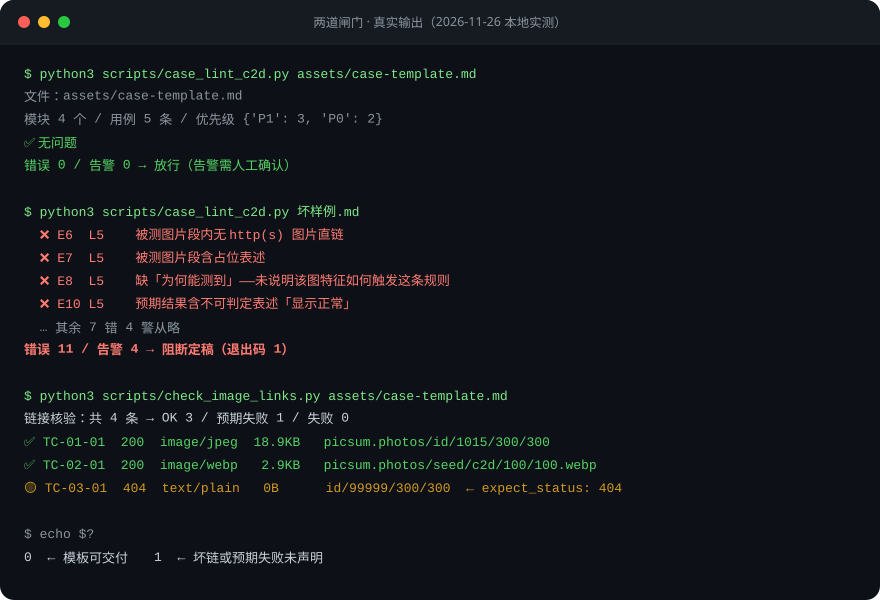

[简体中文](./README.md) | [English](./README.en.md)

<p align="center">
  <picture>
    <source media="(prefers-color-scheme: dark)" srcset="./assets/hero-dark.svg">
    
  </picture>
</p>

<h1 align="center">xxuntuil-test-skills</h1>

<p align="center"><strong>把测试工程的方法、产物标准与机械闸门装进 Agent。</strong></p>

<p align="center">面向 AI Agent 的测试 Skill 合集。<br>一个目录一个 skill，拷进宿主目录即生效，不改宿主代码。</p>

<p align="center">
  <a href="https://github.com/Jasonlya/xxuntuil-test-skills/actions/workflows/check.yml"></a>
  <a href="./skills/"></a>
  <a href="./CHANGELOG.md"></a>
  
  
  <a href="./LICENSE"></a>
</p>

---

把测试方法、产出标准和**能机判的闸门**一起装进 Agent：当前收录 1 个 skill。它把「图片校验用例怎么写」从口头要求变成可执行格式——**每条用例强制挂真实图片直链，并声明这张图为什么能触发该规则**。配套 47 条场景规则、13 个实测图源、两道退出码即判决的闸门。

[快速开始](#快速开始) · [技能清单](#技能清单) · [工作原理](#工作原理) · [用例长什么样](#用例长什么样) · [两道闸门](#两道闸门) · [场景矩阵](#场景矩阵6-组-47-条) · [兼容性与边界](#兼容性与边界) · [实测记录](#实测记录) · [文档导航](#文档导航)

## 快速开始

### 1. 安装

```bash
git clone git@github.com:Jasonlya/xxuntuil-test-skills.git
cd xxuntuil-test-skills
./install.sh                 # 全部 skill → ~/.workbuddy/skills/
```

`install.sh` 是纯拷贝，不改宿主任何配置。覆盖已装版本时**把旧目录改名成 `.bak.<时间戳>` 备份，不删除**。

<details>
<summary><strong>只装一个 / 装到项目里 / 升级与卸载</strong></summary>

```bash
./install.sh --list                            # 看仓库里有哪些 skill
./install.sh c2d-case-writing                  # 只装一个
./install.sh -d ~/proj/.workbuddy/skills       # 装到指定目录（项目级，随 git 共享给团队）
./install.sh --force c2d-case-writing          # 覆盖已装版本
```

环境变量 `WORKBUDDY_SKILLS_DIR` 可替代 `-d`。**升级**：`git pull` 后重跑原命令。**卸载**：删掉宿主目录下对应的 skill 目录即可，仓库里始终留全量。

手动复制也行——把 `skills/` 下一级目录整个拷进宿主 skills 目录，目录名必须与 `SKILL.md` 的 `name` 一致：

| 范围 | 目录 | 适用 |
|---|---|---|
| 个人 | `~/.workbuddy/skills/` | 所有项目可用 |
| 项目 | `<仓库根>/.workbuddy/skills/` | 只对该仓库生效，随 git 流转 |

</details>

### 2. 确认真的被装载了

新开一个会话，说一句「帮我写 C2D 图片校验的用例」。能看到它去读 `SKILL.md` 与 `references/` 才算成功。

**目录存在 ≠ 触发成功。** 触发靠 frontmatter 的 `description`，装载靠文件名与 `name` 一致——这两处是最常见的静默失败点，`scripts/check_repo.py` 都会拦。

### 3. 第一次用：模板 → 改 → 过闸门

```bash
SKILL=~/.workbuddy/skills/c2d-case-writing

cp $SKILL/assets/case-template.md 测试用例_C2D图片_markmap.md
# 按你的设计稿改内容，然后跑两道闸门
python3 $SKILL/scripts/case_lint_c2d.py 测试用例_C2D图片_markmap.md
python3 $SKILL/scripts/check_image_links.py 测试用例_C2D图片_markmap.md \
  --out 图片素材核验_$(date +%Y%m%d).md
```

两个脚本退出码为 0 才交付。也可以什么都不敲，直接在对话里让它按你的设计稿生成——skill 触发后会自己走完六阶段。

## 技能清单

| Skill | 能力 | 主要产物 | 版本 |
|---|---|---|---|
| [c2d-case-writing](./skills/c2d-case-writing/SKILL.md) | 为 C2D（设计稿转代码）编写图片校验用例：每条挂真实图片直链 + 声明该图为何能触发规则；含场景盘点、澄清、交付核对与两道闸门 | 测试用例 markmap、机读 Schema、图片核验报告 | `v0.1.0` |

合集规划中：需求建模、测试策略、用例审查、接口测试、flaky 治理。（宁缺毋滥，写完并实测过再进来。）

### c2d-case-writing 解决什么

图片类 bug 很少出在业务逻辑里，几乎都在**资源与渲染管线的边界**上：填充模式、裁剪、蒙版、透明通道、倍率、格式降级、加载回退。这类用例有两个共性问题：

1. **纯文字写不出可执行用例**——「用一张长图测裁剪」，执行者不知道多长、什么比例、什么格式。两个人测出的结论不可比，回归时也没法复现。
2. **图不对等于没测**——用 1:1 的图测 FILL 裁切，容器也是 1:1，压根不产生裁切。用例「通过」了，但什么都没验证到。

所以每条用例钉死两样东西：**一张具体的图（直链）**，和**这张图为什么能测到这个场景**。规则写进 `references/image-rule-matrix.md`，链接写进 `references/image-fixture-registry.md`，能不能过由脚本判。

## 工作原理

<p align="center">
  
</p>

四点设计取向：

- **产物落盘，文件即状态**。每阶段产物是文件，不是聊天记录。中断后把产物目录给 Agent，就能按「阶段完成判据」续跑。
- **不确定就停下来问，不硬猜**。设计稿看不出填充模式、超大图没有约定、签名 URL 有效期未知——这些是澄清题，不是用例内容。无人值守环境里转为未决项，不代答。
- **排除必须写理由**。场景盘点阶段逐条 include / exclude，写不出理由的一律按漏测处理。分母先立住，才谈得上覆盖。
- **能机判的不写散文**。写在散文里的红线，弱模型会跳过，评审方也没法逐条复核。所以设闸门。

## 用例长什么样

````markdown
### TC-01-01 [P1] 封面图 FILL 模式：3:1 图裁切填满 1.875:1 容器
- 规则：IMG-FILL-03｜触发条件：imageFill 模式 = FILL 且图宽高比 ≠ 容器宽高比
- 前置：设计稿 {文件链接} 页面 {页面名} / 节点 {nodeId}（容器 375×200）；环境 {URL} 账号 {账号}
- 被测图片：https://picsum.photos/id/1015/1200/400
  - 特征：jpeg｜1200×400｜3:1｜103KB｜不透明
  - 为何能测到：3:1 放进 1.875:1 容器必然上下裁切，裁剪量可测（约 20px），裁剪位置可观察
- 操作步骤：
  1. 打开 {设计稿链接}，确认节点 {nodeId} 的填充模式为 FILL
  2. 触发 C2D 生成，拿到产物 HTML
  3. 浏览器 1440×900 视口打开产物，DevTools 选中该图片元素
- 预期结果：
  - 产物中该图为 ``，`src` 为上述直链，`object-fit: cover`
  - 渲染尺寸 375×200（±1px），图片上下各裁约 20px（±2px），无留白、无拉伸
  - 加载完成 ≤3s；超时仍空白判失败
````

五段式（规则 / 前置 / 被测图片 / 操作步骤 / 预期结果）+ 一个必填段「为何能测到」。**「被测图片」段里的特征和「为何能测到」，是本 skill 与普通用例最大的差别**——没有这两样，闸门直接拦。

预期必须可判定：禁「显示正常 / 效果良好 / 无问题」。要落到像素尺寸、裁剪边距与容差、`object-fit` 取值、Content-Type、体积上限、差异像素比、加载时限。

## 两道闸门

<p align="center">
  
</p>

| 闸门 | 检查什么 | 退出码 |
|---|---|---|
| [`case_lint_c2d.py`](./skills/c2d-case-writing/scripts/case_lint_c2d.py) | 12 项 E（缺段、无直链、占位符、本地路径、`data:` 内联、缺「为何能测到」、预期不可判定、TC 编号与模块不符…）+ 6 项 W（缺特征行、缺优先级、异步无时限…） | 1 = 有 E，阻断定稿 |
| [`check_image_links.py`](./skills/c2d-case-writing/scripts/check_image_links.py) | 逐条 GET，核对状态码、`Content-Type` 是否 `image/*`、体积；跟随重定向 | 1 = 有非预期失败 |

**区分「坏链」与「预期失败」**：加载回退场景本来就需要 404，用例里写 `expect_status: 404`，命中即判 `EXPECTED` 放行；不写就按坏链处理。

两个脚本都零第三方依赖（`re` / `pathlib` / `urllib`），不调模型，可进 CI。

## 场景矩阵（6 组 47 条）

完整表格与每条规则的「必配图片特征」见 [`references/image-rule-matrix.md`](./skills/c2d-case-writing/references/image-rule-matrix.md)。

| 组 | 规则前缀 | 条数 | 覆盖的场景 | 图片必须满足 |
|---|---|:--:|---|---|
| A 设计稿侧填充 | `IMG-FILL` | 10 | FILL / FIT / STRETCH / TILE、九宫格、混合模式 | 宽高比与容器**明显不同** |
| B 裁剪、蒙版与几何 | `IMG-CROP` | 8 | 圆角、圆形、mask、旋转、翻转、自定义裁剪 | 带**可辨方向**或四象限色块 |
| C 导出与格式 | `IMG-EXP` | 10 | png/jpg/webp/svg、倍率、极端尺寸、超大体积 | 目标格式 + 边界尺寸 |
| D 代码渲染 | `IMG-CODE` | 11 | `src`、`object-fit`、`alt`、`loading`、`srcset`、路径编码 | 可区分原始与降级版本 |
| E 加载失败与降级 | `IMG-FALL` | 5 | 404、非图片资源、慢加载、跨域、防盗链 | 显式 `expect_status` |
| F 视觉一致性 | `IMG-VIS` | 3 | 差异像素比、色差阈值、缩放锐度 | 含细节纹理，非纯色 |

最容易踩的一条：**用与容器同比例的图测 FILL，永远测不出裁切**。矩阵里每条规则都写了「必配图片特征」，就是防这个。

## 图源登记表（13 个实测直链）

全部为图片直链，无需登录、无防盗链。完整清单见 [`references/image-fixture-registry.md`](./skills/c2d-case-writing/references/image-fixture-registry.md)。

| 槽位 | 直链 | 格式 | 尺寸 | 用途 |
|---|---|---|---|---|
| `FIX-1X1` | `https://picsum.photos/1/1` | jpeg | 1×1 | 极小尺寸边界 |
| `FIX-3X1` | `https://picsum.photos/id/1015/1200/400` | jpeg | 1200×400 | FILL 裁切（3:1 进 1.875:1） |
| `FIX-ULTRAWIDE` | `https://picsum.photos/id/1015/3000/10` | jpeg | 3000×10 | 极端比例（300:1） |
| `FIX-HUGE` | `https://picsum.photos/id/1025/4096/4096` | jpeg | 4096² | 超大图与压缩策略 |
| `FIX-WEBP` | `https://picsum.photos/seed/c2d/100/100.webp` | webp | 100×100 | 格式降级 |
| `FIX-SVG` | `https://placehold.co/200x200.svg` | svg | 200×200 | 矢量导出 |
| `FIX-BROKEN-404` | `https://picsum.photos/id/99999/300/300` | — | — | 加载回退（`expect_status: 404`） |

两个坑已写进登记表：**picsum 会 302 跳到 `fastly.picsum.photos/...?hmac=...`**，签名会变，所以用例里只写 `picsum.photos` 原 URL、核验脚本必须跟随重定向；**签名 URL 不要写进用例**，几天后集体 404，整套用例报废。

## 兼容性与边界

skill 以 Markdown 指令 + 相对路径引用 + 按需运行的标准库脚本分发，不依赖 SDK，也不依赖除图源外的任何网络服务。

| 宿主 | 目录 | 验证范围 |
|---|---|---|
| WorkBuddy | `~/.workbuddy/skills/` 或项目 `.workbuddy/skills/` | 主要适配对象；本机实测 |
| Claude Code | `~/.claude/skills/` 或项目 `.claude/skills/` | 目录结构兼容，未在该宿主实测产出效果 |
| 其他支持 `SKILL.md` 的宿主 | 依其规则 | 结构可适配，触发与产出需各自验证 |

**语言**：文档与 skill 指令正文为中文。**范围**：聚焦 C2D 图片链路的黑盒校验用例，不含生成代码的单元测试、性能压测、安全扫描。**未覆盖**：原生 Windows（建议 WSL）；除 macOS 外的平台未实测。

## 仓库结构

```text
skills/                    产品：每个 skill 一个目录
  c2d-case-writing/
    SKILL.md               唯一入口：铁律、五段式、六阶段工作流、常见错误
    references/            按需加载：场景矩阵、图源登记表、格式细则
    assets/                可直接复制的用例模板（含金标准样例）
    scripts/               两道闸门，零第三方依赖
scripts/check_repo.py      仓库自检：命名 / 元数据 / 断链 / 本地路径 / 脚本语法
.github/workflows/check.yml  push 与 PR 自动跑自检
install.sh                 安装脚本（单装 / 全装 / 项目级 / 备份式覆盖）
assets/                    README 图示（明暗双版横幅、工作流、闸门输出）
```

## 新增 skill 约定

合集要长大，得先有规矩。下面第 1、2 条被 `scripts/check_repo.py` 当作错误拦：

1. **目录名 == frontmatter `name`**，小写连字符、≤40 字符。破了就是静默不加载。
2. **`description` 写清三件事**：做什么 + 什么时候用 + 触发词原话。它是唯一常驻上下文的部分。
3. **正文只留骨架**，细则进 `references/`、模板进 `assets/`、能跑的逻辑进 `scripts/`。SKILL.md 建议 ≤500 行。
4. **能机判的别写成散文**，写成脚本；并说清闸门判不了什么。
5. **不编事实**。查不到的字段名、阈值来源写 `TODO：向 {谁} 确认 {什么}`，不用「通常/一般应该是」填。

提交前跑一遍：

```bash
python3 scripts/check_repo.py
```

## 实测记录

以下均为本机真实执行结果（macOS · Python 3.13 · 2026-11-26），不是估算：

| 场景 | 结果 |
|---|---|
| `case_lint_c2d.py` 跑模板（4 模块 / 5 条用例） | 0 错 0 警 → 放行，退出码 0 |
| 同上跑一份故意写坏的 2 条用例 | **11 错 4 警 → 阻断**，退出码 1 |
| `check_image_links.py` 跑模板（4 条链接） | OK 3 / 预期失败 1 / 失败 0，退出码 0 |
| 删掉那条 404 用例的 `expect_status` | 同一条立刻判坏链，退出码 1 |
| 13 个图源逐个 curl | 全部 200 且 `Content-Type` 匹配 |
| `check_repo.py` 负向验证（name 不符 + 断链 + 本地路径 + 脚本语法错） | 4 类全部报出，退出码 1 |

**没有做的事**：没做过「有 skill vs 无 skill」的产出质量对照，所以这里不写任何百分比提升。等有对照实验再补。

## 文档导航

| 文档 | 适合何时阅读 |
|---|---|
| [c2d-case-writing/SKILL.md](./skills/c2d-case-writing/SKILL.md) | 想直接看这个 skill 怎么干活 |
| [image-rule-matrix.md](./skills/c2d-case-writing/references/image-rule-matrix.md) | 只要场景清单，不要用例 |
| [image-fixture-registry.md](./skills/c2d-case-writing/references/image-fixture-registry.md) | 找能用的真实图片直链 |
| [case-format-c2d.md](./skills/c2d-case-writing/references/case-format-c2d.md) | 用例编号、导读四件套、附录规范 |
| [case-template.md](./skills/c2d-case-writing/assets/case-template.md) | 要一份能直接改的起点 |
| [CONTRIBUTING.md](./CONTRIBUTING.md) | 想加一个 skill 或改现有内容 |
| [CHANGELOG.md](./CHANGELOG.md) | 查版本变更 |
| [LICENSE](./LICENSE) | MIT |

## 贡献与反馈

欢迎按[贡献指南](./CONTRIBUTING.md)提交改进。可复现的问题与具体需求走 [Issues](https://github.com/Jasonlya/xxuntuil-test-skills/issues)。

## License

[MIT](./LICENSE)
