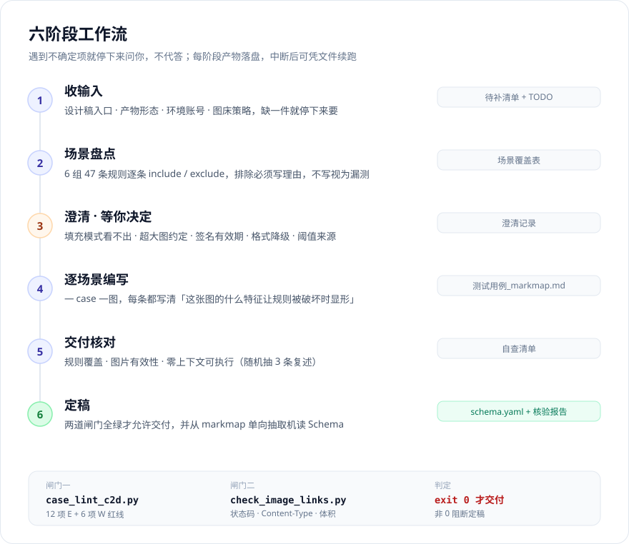
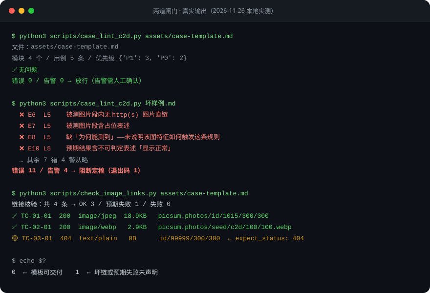

[← 返回合集](../../README.md)

# c2d-case-writing

> 为 C2D（设计稿转代码）编写图片校验用例：每条强制挂真实图片直链，并声明这张图**为什么**能触发该规则。

`v0.1.0` · 6 组 47 条场景规则 · 13 个实测图源 · 2 道机判闸门 · 零第三方依赖

- [什么时候用它](#什么时候用它)
- [用例长什么样](#用例长什么样)
- [六阶段工作流](#六阶段工作流)
- [两道闸门](#两道闸门)
- [场景矩阵](#场景矩阵6-组-47-条)
- [图源登记表](#图源登记表13-个实测直链)
- [安装与使用](#安装与使用)
- [实测记录](#实测记录)
- [已知边界](#已知边界)

## 什么时候用它

**用**：

- 为 C2D 写图片校验用例（MasterGo 图片填充 / 导出 / 生成代码渲染 / 加载回退）
- 把一份场景清单（长图裁剪、webp 降级、透明通道丢失…）落成可执行用例
- 审查既有图片用例：每条是否挂真图、图的特征是否真能测到点
- 按规则编号（`IMG-*`）建立「规则 ↔ 用例」的可回归映射

**不用**：

| 你的诉求 | 该去哪 |
|---|---|
| 非图片类功能用例（表单、权限、状态机、接口契约） | 通用用例 skill |
| 需求建模、测试策略与范围决策 | 需求分析 / 测试策略 skill |
| 用例转 Playwright / API 自动化 | E2E / 接口测试 skill |
| 只要场景清单、不要用例 | 直接读 [image-rule-matrix.md](./references/image-rule-matrix.md)，不必触发本 skill |
| 已确认缺陷的根因定位 | Bug 分析 skill |

完整边界写在 [SKILL.md](./SKILL.md) 的 When NOT to Use。

## 用例长什么样

````markdown
### TC-01-01 [P1] 封面图 FILL 模式：3:1 图裁切填满 1.875:1 容器
- 规则：IMG-FILL-03｜触发条件：imageFill 模式 = FILL 且图宽高比 ≠ 容器宽高比
- 前置：设计稿 {文件链接} 页面 {页面名} / 节点 {nodeId}（容器 375×200）；环境 {URL} 账号 {账号}
- 被测图片：https://picsum.photos/id/1015/1200/400
  - 特征：jpeg｜1200×400｜3:1｜103KB｜不透明
  - 为何能测到：3:1 放进 1.875:1 容器必然上下裁切，裁剪量可测（约 20px），裁剪位置可观察
- 操作步骤：
  1. 打开 {设计稿链接}，确认节点 {nodeId} 的填充模式为 FILL
  2. 触发 C2D 生成，拿到产物 HTML
  3. 浏览器 1440×900 视口打开产物，DevTools 选中该图片元素
- 预期结果：
  - 产物中该图为 ``，`src` 为上述直链，`object-fit: cover`
  - 渲染尺寸 375×200（±1px），图片上下各裁约 20px（±2px），无留白、无拉伸
  - 加载完成 ≤3s；超时仍空白判失败
````

五段式（规则 / 前置 / 被测图片 / 操作步骤 / 预期结果）+ 一个必填段「为何能测到」。

**「被测图片」段里的特征和「为何能测到」，是这个 skill 与普通用例最大的差别**——没有这两样，闸门直接拦。原因很实在：用 1:1 的图测 FILL 裁切，容器也是 1:1，压根不产生裁切，用例「通过」了但什么都没验证到。

预期必须可判定：禁「显示正常 / 效果良好 / 无问题」，要落到像素尺寸、裁剪边距与容差、`object-fit` 取值、Content-Type、体积上限、差异像素比、加载时限。

## 六阶段工作流

<p align="center">
  
</p>

- **产物落盘，文件即状态**：中断后把产物目录给 Agent，按阶段完成判据续跑
- **不确定就停下来问**：设计稿看不出填充模式、超大图无约定、签名 URL 有效期未知——这些是澄清题，不是用例内容
- **排除必须写理由**：逐条 include / exclude，写不出理由按漏测处理

## 两道闸门

<p align="center">
  
</p>

| 闸门 | 检查什么 | 退出码 |
|---|---|---|
| [`case_lint_c2d.py`](./scripts/case_lint_c2d.py) | 12 项 E（缺段、无直链、占位符、本地路径、`data:` 内联、缺「为何能测到」、预期不可判定、TC 编号与模块不符…）+ 6 项 W（缺特征行、缺优先级、异步无时限…） | 1 = 有 E，阻断定稿 |
| [`check_image_links.py`](./scripts/check_image_links.py) | 逐条 GET，核对状态码、`Content-Type` 是否 `image/*`、体积；跟随重定向 | 1 = 有非预期失败 |

**区分「坏链」与「预期失败」**：加载回退场景本来就需要 404，用例里写 `expect_status: 404`，命中即判 `EXPECTED` 放行；不写就按坏链处理。

## 场景矩阵（6 组 47 条）

每条规则都写了「必配图片特征」与「可判定预期」，完整表格见 [image-rule-matrix.md](./references/image-rule-matrix.md)。

| 组 | 规则前缀 | 条数 | 覆盖的场景 | 图片必须满足 |
|---|---|:--:|---|---|
| A 设计稿侧填充 | `IMG-FILL` | 10 | FILL / FIT / STRETCH / TILE、九宫格、混合模式 | 宽高比与容器**明显不同** |
| B 裁剪、蒙版与几何 | `IMG-CROP` | 8 | 圆角、圆形、mask、旋转、翻转、自定义裁剪 | 带**可辨方向**或四象限色块 |
| C 导出与格式 | `IMG-EXP` | 10 | png/jpg/webp/svg、倍率、极端尺寸、超大体积 | 目标格式 + 边界尺寸 |
| D 代码渲染 | `IMG-CODE` | 11 | `src`、`object-fit`、`alt`、`loading`、`srcset`、路径编码 | 可区分原始与降级版本 |
| E 加载失败与降级 | `IMG-FALL` | 5 | 404、非图片资源、慢加载、跨域、防盗链 | 显式 `expect_status` |
| F 视觉一致性 | `IMG-VIS` | 3 | 差异像素比、色差阈值、缩放锐度 | 含细节纹理，非纯色 |

## 图源登记表（13 个实测直链）

全部为图片直链，无需登录、无防盗链。完整清单与自备槽位规范见 [image-fixture-registry.md](./references/image-fixture-registry.md)。

| 槽位 | 直链 | 格式 | 尺寸 | 用途 |
|---|---|---|---|---|
| `FIX-1X1` | `https://picsum.photos/1/1` | jpeg | 1×1 | 极小尺寸边界 |
| `FIX-3X1` | `https://picsum.photos/id/1015/1200/400` | jpeg | 1200×400 | FILL 裁切（3:1 进 1.875:1） |
| `FIX-ULTRAWIDE` | `https://picsum.photos/id/1015/3000/10` | jpeg | 3000×10 | 极端比例（300:1） |
| `FIX-HUGE` | `https://picsum.photos/id/1025/4096/4096` | jpeg | 4096² | 超大图与压缩策略 |
| `FIX-WEBP` | `https://picsum.photos/seed/c2d/100/100.webp` | webp | 100×100 | 格式降级 |
| `FIX-SVG` | `https://placehold.co/200x200.svg` | svg | 200×200 | 矢量导出 |
| `FIX-BROKEN-404` | `https://picsum.photos/id/99999/300/300` | — | — | 加载回退（`expect_status: 404`） |

两个坑：**picsum 会 302 跳到 `fastly.picsum.photos/...?hmac=...`**，签名会变，所以用例里只写 `picsum.photos` 原 URL、核验脚本必须跟随重定向；**签名 URL 不要写进用例**，几天后集体 404，整套用例报废。

## 安装与使用

```bash
# 从合集仓库装（只装这一个）
./install.sh c2d-case-writing

# 或者手动拷目录到宿主 skills 目录，目录名必须叫 c2d-case-writing
SKILL=<宿主 skills 目录>/c2d-case-writing

# 起一份用例
cp $SKILL/assets/case-template.md 测试用例_C2D图片_markmap.md

# 过闸门，退出码 0 才交付
python3 $SKILL/scripts/case_lint_c2d.py 测试用例_C2D图片_markmap.md
python3 $SKILL/scripts/check_image_links.py 测试用例_C2D图片_markmap.md \
  --out 图片素材核验_$(date +%Y%m%d).md
```

装上之后不必手敲命令：在对话里说「帮我写 C2D 图片校验的用例」，skill 会自己走完六阶段。

产物三件：`测试用例_C2D图片_markmap.md`（人工维护的唯一源）、`.schema.yaml`（由 markmap 单向抽取）、`图片素材核验_{日期}.md`（闸门二生成）。

## 实测记录

本机真实执行结果（macOS · Python 3.13 · 2026-11-26）：

| 场景 | 结果 |
|---|---|
| `case_lint_c2d.py` 跑模板（4 模块 / 5 条用例） | 0 错 0 警 → 放行，退出码 0 |
| 同上跑一份故意写坏的 2 条用例 | **11 错 4 警 → 阻断**，退出码 1 |
| `check_image_links.py` 跑模板（4 条链接） | OK 3 / 预期失败 1 / 失败 0，退出码 0 |
| 删掉那条 404 用例的 `expect_status` | 同一条立刻判坏链，退出码 1 |
| 13 个图源逐个 curl | 全部 200 且 `Content-Type` 匹配 |

没做过「有 skill vs 无 skill」的产出质量对照，所以不提供提升百分比。

## 已知边界

- **MasterGo API 有 5 项未核实**：填充模式字段名与枚举、mask 判定方式、blendMode 是否暴露、OpenAPI 导出端点、签名有效期。按 [case-format-c2d.md](./references/case-format-c2d.md) 附录 B 的约定写成 `TODO：向 {谁} 确认 {什么}`，不做猜测性断言——用例前提写错比留空危害大。
- **图源是第三方免费服务**：picsum.photos 与 placehold.co 不承诺 SLA。失效时按登记表的自备槽位规范替换，再重跑闸门二。
- **只在 macOS + WorkBuddy 实测**：其余宿主按 `SKILL.md` 标准结构应当兼容，但未验证产出效果。

---

[← 返回合集](../../README.md) · [SKILL.md](./SKILL.md) · [场景矩阵](./references/image-rule-matrix.md) · [格式细则](./references/case-format-c2d.md)
